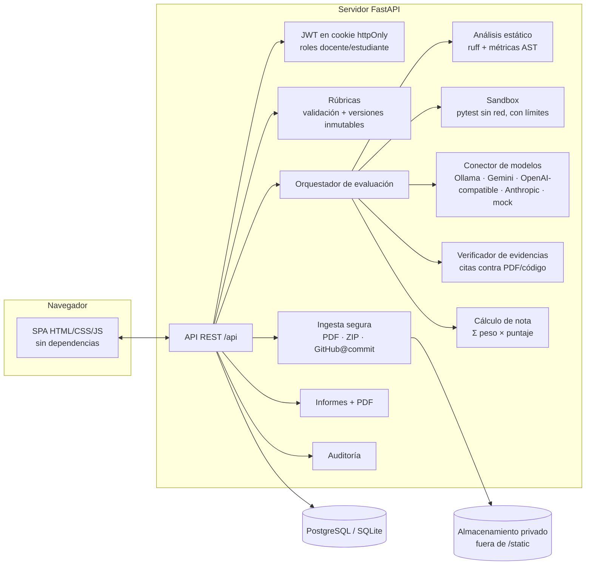
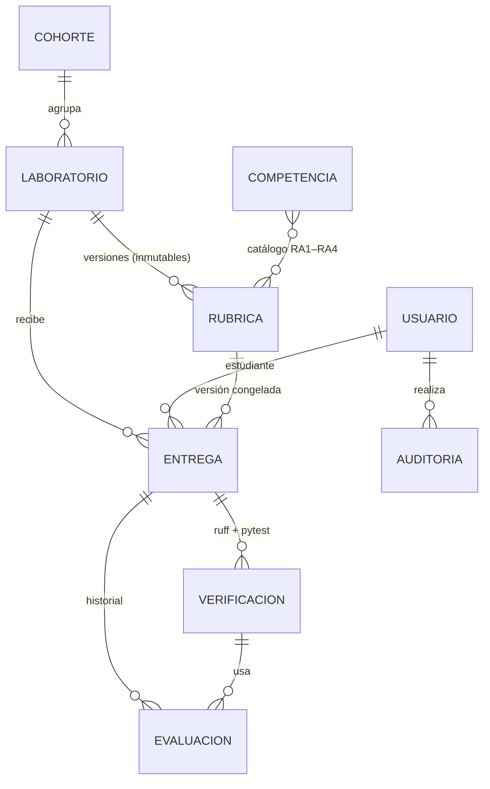

# Manual técnico — Asesor Pedagógico Inteligente

Plataforma web que recibe los trabajos de las cohortes 1 y 2 con su rúbrica, verifica evidencias, propone una valoración con IA, calcula la nota de 0,0 a 5,0 en el servidor, la somete a aprobación docente y construye un informe integrado por estudiante, cohorte y laboratorio.

## 1. Arquitectura



| Capa | Tecnología | Archivo(s) |
|---|---|---|
| Frontend | HTML + CSS + JavaScript sin librerías (compatible con CSP estricta) | `static/` |
| API | FastAPI 0.163, Pydantic 2 | `app/api.py`, `app/main.py` |
| Persistencia | SQLAlchemy 2 (SQLite local, PostgreSQL en producción) | `app/models.py`, `app/db.py` |
| Autenticación | JWT HS256 en cookie httpOnly + SameSite=Strict; bcrypt (12 rondas) | `app/security.py` |
| Rúbricas | Esquema Pydantic + validación de coherencia + SHA-256 | `app/rubrics.py` |
| Ingesta | pypdf, zipfile con protección zip-slip, API de GitHub | `app/ingest.py` |
| Verificación de código | ruff (estilo, errores, bugs, complejidad, seguridad) + pytest | `app/code_check.py` |
| Sandbox | Docker / namespaces de Linux / rlimits | `app/sandbox.py` |
| IA | Conector configurable y esquema JSON de salida | `app/llm/` |
| Evidencias | Verificación textual con normalización y trigramas | `app/evidence.py` |
| Nota | Aritmética decimal, redondeo half-up | `app/grading.py` |
| Informes | Agregación + PDF con ReportLab | `app/reports.py` |

## 2. Modelo de datos



- **Rubrica**: cada edición crea una versión nueva (`version`, `sha256`). Solo una versión válida está `activa` por laboratorio. Las inválidas quedan como borrador con sus `errores`.
- **Entrega**: guarda `rubrica_id` en el momento de la carga. Si el docente cambia la rúbrica después, la entrega sigue evaluándose con su versión original.
- **Evaluacion**: guarda proveedor, modelo, parámetros, `schema_version`, `prompt_sha256`, `entrada_sha256`, respuesta validada, resultado con evidencias verificadas, alertas, nota preliminar, decisión docente, ajustes y nota final.
- **Auditoria**: registro de cada acción (login, carga, verificación, evaluación, ajuste, publicación, descarga de informe, cambios de configuración).

## 3. Flujo de evaluación

```mermaid
sequenceDiagram
  participant D as Docente
  participant A as API
  participant S as Sandbox
  participant M as Modelo (LLM)
  D->>A: Cargar entrega (PDF + ZIP/GitHub)
  A->>A: Extraer texto por página, rechazar PDF sin texto, congelar rúbrica
  D->>A: Evaluar
  A->>A: ruff (lectura, sin ejecutar)
  A->>S: pytest con timeout, memoria limitada y sin red
  S-->>A: junit XML + consola (se contrastan)
  A->>M: Prompt versionado + rúbrica + material delimitado + resultados objetivos
  M-->>A: JSON (niveles + citas), nunca una nota
  A->>A: Validar con Pydantic + reglas semánticas (hasta 3 intentos con corrección)
  A->>A: Verificar cada cita en el PDF/código; ubicar página o archivo:línea
  A->>A: Niveles automáticos para criterios de pruebas/análisis estático
  A->>A: nota = Σ peso/100 × puntaje del nivel (redondeo half-up a 1 decimal)
  A->>A: Alertas: citas no verificadas, inyección, sandbox parcial, reproducibilidad
  A-->>D: Evaluación PRELIMINAR (invisible para el estudiante)
  D->>A: Aprobar, o ajustar niveles con justificación obligatoria
  A->>A: Recalcular nota en el servidor, publicar, auditar
```

### 3.1 La nota nunca la calcula el LLM

1. El esquema de salida (`app/llm/schemas.py`) no tiene campo de nota y usa `extra="forbid"`: si el modelo agrega `"nota": 5`, la respuesta se rechaza.
2. El modelo solo elige un `nivel_id` por criterio. El backend busca el puntaje de ese nivel en la rúbrica congelada.
3. `app/grading.py`: `nota = Σ (peso_i / 100) × puntaje_i` con `Decimal` y redondeo `ROUND_HALF_UP` a un decimal.
4. Los criterios con `fuente: pruebas` o `analisis_estatico` no los toca el modelo. El backend elige el nivel cuyo `umbral_min` (0–100) alcanza la métrica medida (porcentaje de pruebas aprobadas o índice de calidad).

### 3.2 Validación de la salida del modelo

- **Estructural**: Pydantic → JSON Schema enviado al proveedor (`format` en Ollama, `response_format: json_schema` en OpenAI, *tool use* forzado en Anthropic).
- **Semántica** (`validar_salida`): todos los criterios LLM evaluados exactamente una vez, niveles existentes, evidencia obligatoria para cualquier nivel superior al mínimo y competencias existentes en las actividades.
- Si falla, se reenvía al modelo la lista de errores (máximo 3 intentos). Si sigue fallando, no se crea evaluación y se audita el fallo.

### 3.3 Verificación de evidencias

Cada cita se busca en el texto real del informe (por página) y del código (por archivo y línea), normalizando mayúsculas, tildes, comillas y espacios:

- `exacta`: la cita aparece tal cual.
- `aproximada`: al menos 80 % de sus trigramas coinciden en una misma página, o 70 % de sus líneas en un mismo bloque de código.
- `no_encontrada`: posible alucinación. Genera una alerta media o alta para el docente.

El indicador **evidencias verificadas (%)** de cada evaluación se calcula con estos resultados.

### 3.4 Reproducibilidad

Temperatura 0 y semilla fija por defecto, prompt versionado (`PROMPT_VERSION`) y esquema versionado (`SCHEMA_VERSION`). `entrada_sha256` resume el PDF, el código, la rúbrica, las versiones y el modelo. Al reevaluar la misma entrada, el sistema compara niveles y avisa si cambian. El evaluador `mock` es completamente determinista y las pruebas automáticas exigen resultados idénticos.

## 4. Rúbrica parametrizada

Formato JSON (también editable en el editor visual y descargable con `GET /api/rubricas/esquema`):

```json
{
  "nombre": "Rúbrica Harness 2",
  "competencias": [{"id": "RA2", "nombre": "Diseñar interacciones verificables"}],
  "criterios": [{
    "id": "CR1", "competencia_id": "RA2", "nombre": "Verificación de salidas", "peso": 60, "fuente": "llm",
    "niveles": [
      {"id": "N1", "nombre": "Insuficiente", "puntaje": 1.5, "descriptor": "No verifica salidas."},
      {"id": "N4", "nombre": "Destacado", "puntaje": 5.0, "descriptor": "Valida con esquema e integridad."}
    ]
  }, {
    "id": "CR2", "competencia_id": "RA2", "nombre": "Pruebas", "peso": 40, "fuente": "pruebas",
    "niveles": [
      {"id": "N1", "nombre": "Bajo", "puntaje": 1.5, "descriptor": "< 50 %", "umbral_min": 0},
      {"id": "N2", "nombre": "Alto", "puntaje": 5.0, "descriptor": "100 %", "umbral_min": 100}
    ]
  }]
}
```

**Se rechaza** (HTTP 422, con todos los errores y un borrador para corregir) cuando los pesos no suman 100 %; hay criterios o niveles duplicados; un criterio tiene menos de 2 niveles; un nivel no tiene descriptor o nombre; algún puntaje está fuera de 0–5; los niveles no van de menor a mayor o repiten puntaje o descriptor; un criterio apunta a una competencia inexistente; o un criterio objetivo no tiene `umbral_min` creciente que empiece en 0.

**Advertencias** (no bloquean): el nivel máximo no llega a 5,0, hay competencias sin criterios o competencias fuera del catálogo del curso.

También se puede **importar desde PDF/DOCX**: el modelo configurado convierte el documento al JSON y luego pasa por la misma validación.

## 5. Seguridad y protección de datos

| Riesgo | Control |
|---|---|
| Acceso no autorizado | JWT firmado (HS256) en cookie `httpOnly`, `SameSite=Strict` y `Secure` en HTTPS. Expira a las 8 h. |
| Fuerza bruta | Límite de 8 intentos de login por IP y correo cada 5 minutos. |
| Contraseñas | bcrypt, 12 rondas. Mínimo 10 caracteres. |
| Fuga entre estudiantes | Cada consulta filtra por `estudiante_id`. Un estudiante recibe 404 sobre entregas ajenas y no ve notas preliminares ni alertas. |
| Archivos | Se guardan con nombres UUID fuera de la carpeta pública y solo se sirven por endpoints autenticados. Tamaños limitados y verificación de firma `%PDF`. |
| ZIP malicioso | Rechazo de rutas absolutas o con `..` y de enlaces simbólicos; límite de 3000 archivos y 80 MB descomprimidos. Se ignoran `.git`, `node_modules` y entornos virtuales. |
| SSRF por GitHub | Solo URLs `https://github.com/usuario/repo`, validadas con expresión regular estricta. |
| Código malicioso | Sandbox (sección 6). El análisis estático no ejecuta código. |
| Reporte de pruebas falsificado | El XML se lee con `defusedxml` y se contrasta con la consola. Si no coinciden, se toma el menor valor y se emite una alerta alta. |
| Inyección de instrucciones | El material va delimitado y declarado como dato en el prompt; detección de patrones con alerta alta; nota calculada por el backend; aprobación docente obligatoria. |
| Cabeceras | CSP sin scripts en línea, `X-Frame-Options: DENY`, `nosniff`, `Referrer-Policy`. |
| Secretos | Solo en variables de entorno, nunca en la base de datos ni en la UI. El sandbox recibe un entorno vacío. |
| Trazabilidad | Tabla `auditoria` con usuario, acción, entidad y detalle. |

## 6. Sandbox de ejecución

| Modo | Aislamiento | Red | Dónde funciona |
|---|---|---|---|
| `docker` | Completo: contenedor efímero, `--network none`, `--read-only`, `--cap-drop ALL`, `no-new-privileges`, usuario `nobody`, 512 MB, 1 CPU, 128 procesos | Deshabilitada | VPS o máquina propia con Docker (`docker-compose.yml`) |
| `unshare` | Alto: namespace de red vacío + `RLIMIT_AS`, `RLIMIT_CPU`, `RLIMIT_FSIZE`, `RLIMIT_NOFILE` + entorno limpio + grupo de procesos que se mata al vencer el tiempo | Deshabilitada | Linux con user namespaces |
| `rlimit` | Parcial: límites de recursos + bloqueo de sockets en Python | Bloqueada en Python | Cualquier plataforma (p. ej. Railway si no permite namespaces) |

`SANDBOX_MODE=auto` elige el mejor disponible. El modo usado queda guardado en cada verificación y, si es parcial, la evaluación muestra una alerta. Para **aislamiento completo** construya la imagen `sandbox/Dockerfile` y despliegue con `docker-compose.yml`.

> Montar `/var/run/docker.sock` en el contenedor de la app le da control sobre Docker del host. Úselo solo en un servidor dedicado al proyecto. Una alternativa más estricta es un servicio de ejecución separado (gVisor, Firecracker).

Las pruebas corren **sin internet**, por lo que el código del estudiante solo puede usar la biblioteca estándar y los paquetes preinstalados. La imagen Docker incluye pytest, numpy, pandas, scikit-learn, matplotlib, requests y pydantic.

## 7. Instalación y despliegue

### 7.1 Local (desarrollo)

```bash
python -m venv .venv && source .venv/bin/activate      # Windows: .venv\Scripts\activate
pip install -r requirements.txt
cp .env.example .env    # edite SECRET_KEY y DEMO_PASSWORD
export $(grep -v '^#' .env | xargs)                     # o defínalas en su IDE
uvicorn app.main:app --reload
# http://localhost:8000   ·   documentación de la API: http://localhost:8000/api/docs
```

### 7.2 Railway (URL pública)

1. Suba el repositorio a GitHub.
2. En Railway: **New Project → Deploy from GitHub repo** (usa el `Dockerfile` y `railway.json`).
3. **Add → Database → PostgreSQL**. Railway inyecta `DATABASE_URL`; la app la convierte al driver `psycopg`.
4. **Add Volume** montado en `/app/data` (informes y código subidos). Agregue `RAILWAY_RUN_UID=0` para que el contenedor pueda escribir en el volumen.
5. Variables: `SECRET_KEY` (aleatoria, 48+ caracteres), `COOKIE_SECURE=true`, `APP_ENV=production`, `DEMO_PASSWORD`, y las del modelo (`LLM_PROVIDER`, `OPENAI_API_KEY` o `ANTHROPIC_API_KEY`).
6. **Settings → Networking → Generate Domain**. Esa es la URL operativa (HTTPS automático).
7. Verifique `https://SU-DOMINIO/api/salud` y entre con la cuenta docente.

En Railway el sandbox suele quedar en `unshare` o `rlimit`; el modo se muestra en «Modelo y sandbox». Para aislamiento completo use 7.3.

### 7.3 Servidor propio con Docker (aislamiento completo)

```bash
docker build -t asesor-sandbox:latest ./sandbox
cp .env.example .env   # edite valores
docker compose up -d                      # app + PostgreSQL
docker compose --profile local-llm up -d  # opcional: Ollama
```

### 7.4 Modelo local con Ollama

```bash
ollama pull qwen2.5:7b        # ~4,7 GB; requiere ~8 GB de RAM o 6 GB de VRAM
```

En «Modelo y sandbox» elija *Ollama*, modelo `qwen2.5:7b` y URL `http://localhost:11434` (o la IP de Tailscale del PC con GPU si la app está en la nube). Ollama ≥ 0.5 soporta salida con JSON Schema.

## 8. API principal

| Método | Ruta | Rol | Uso |
|---|---|---|---|
| POST | `/api/auth/login` | — | Inicia sesión (cookie) |
| GET | `/api/cohortes` | ambos | Portafolio por cohorte y laboratorio |
| POST | `/api/laboratorios/{id}/rubricas` | docente | Nueva versión de rúbrica (422 si es incoherente) |
| POST | `/api/laboratorios/{id}/rubricas/documento` | docente | Importar rúbrica JSON/PDF/DOCX |
| POST | `/api/rubricas/validar` | docente | Validación sin guardar |
| POST | `/api/entregas` | ambos | Cargar informe + código (multipart) |
| POST | `/api/entregas/{id}/verificar` | docente | ruff + pytest en sandbox |
| POST | `/api/entregas/{id}/evaluar` | docente | Evaluación preliminar |
| POST | `/api/evaluaciones/{id}/revision` | docente | Aprobar o ajustar y publicar |
| GET | `/api/informes/estudiante/{id}` (+`/pdf`) | ambos* | Informe integrado |
| GET | `/api/informes/cohorte/{id}` · `/laboratorio/{id}` | docente | Consolidados |
| GET/PUT | `/api/config/modelo` | docente | Conector de modelo |
| GET | `/api/auditoria` | docente | Registro de acciones |

\* El estudiante solo puede consultar su propio informe. Documentación interactiva completa en `/api/docs`.

## 9. Pruebas

```bash
pytest -q          # 61 pruebas
ruff check app tests scripts
```

| Archivo | Qué comprueba |
|---|---|
| `tests/test_rubricas_y_nota.py` | Rúbrica válida, 8 tipos de incoherencia rechazados, JSON malformado, hash estable, fórmula de la nota, extremos 1,5/5,0, redondeo half-up, niveles por umbral |
| `tests/test_confiabilidad.py` | El LLM no puede devolver nota; niveles inexistentes; criterios faltantes; evidencia obligatoria; citas exactas, aproximadas e inventadas; detección de inyección; PDF escaneado rechazado; zip-slip; validación de URLs de GitHub; sandbox corta bucles infinitos, bloquea la red y no expone secretos |
| `tests/test_flujo_demo.py` | Flujo completo de la demostración, reproducibilidad, aislamiento entre estudiantes, permisos por rol, rúbrica rechazada y corregida, alerta por inyección, validaciones de carga y auditoría |

CI: `.github/workflows/ci.yml` corre lint y pruebas en cada push.

## 10. Limitaciones conocidas y trabajo futuro

- Las pruebas que se ejecutan son las que trae el estudiante. Un siguiente paso es permitir **pruebas ocultas del docente** por laboratorio.
- Sin Docker, el aislamiento es alto (`unshare`) o parcial (`rlimit`), y queda indicado en cada evaluación.
- El texto de un PDF escaneado no se puede verificar. Se exige PDF con texto (se podría agregar OCR).
- El análisis estático es completo para Python; para otros lenguajes solo se reportan métricas básicas.
- La evaluación es síncrona. Con modelos lentos conviene una cola de tareas (RQ o Celery).
- El evaluador `mock` es heurístico: sirve para demostrar el flujo sin costo, no para calificar de verdad.
